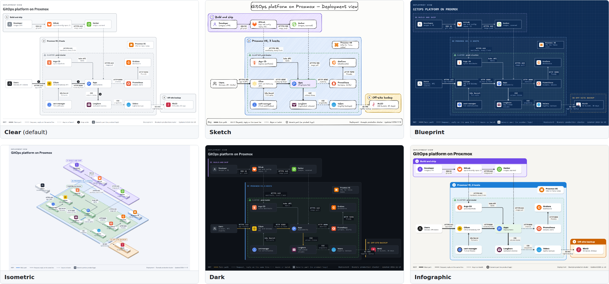
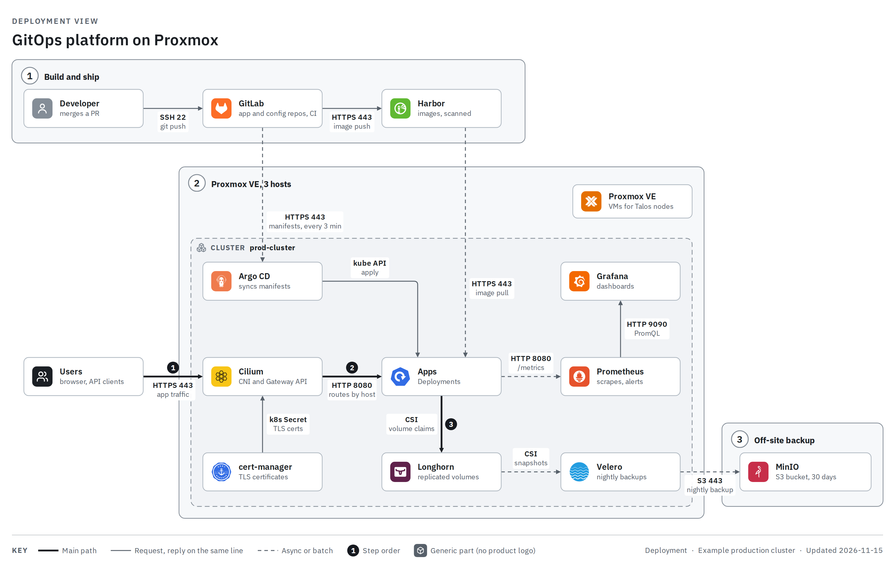
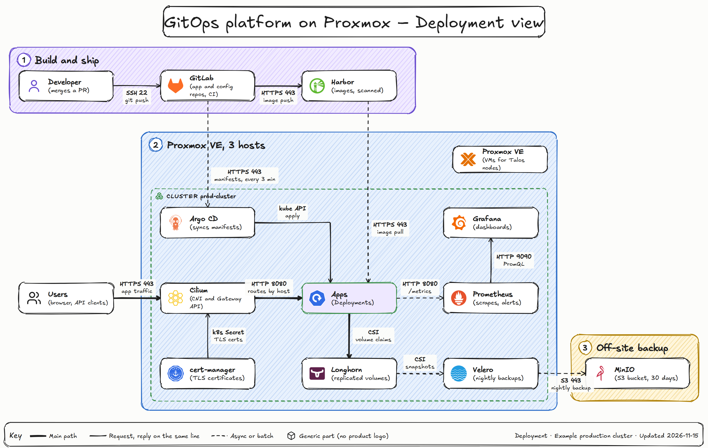
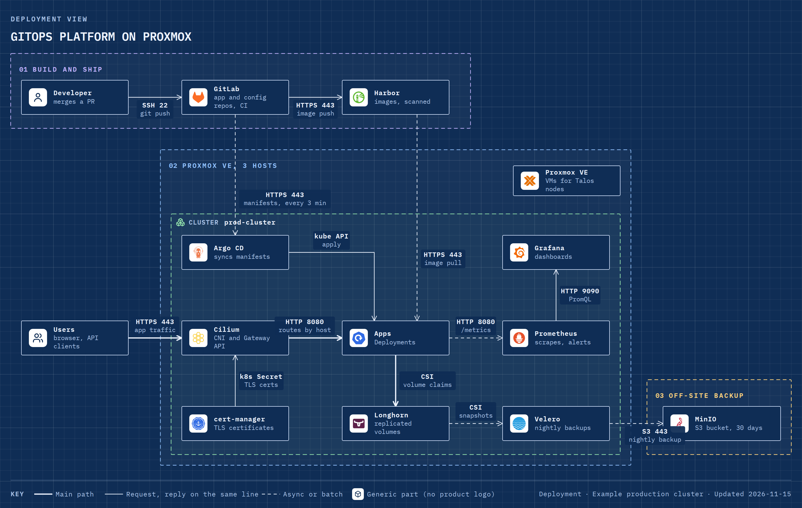
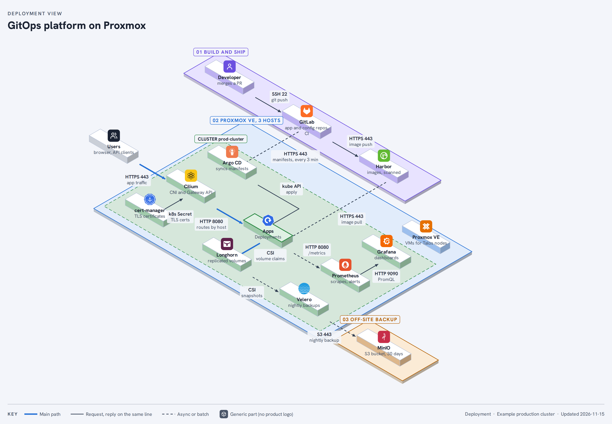
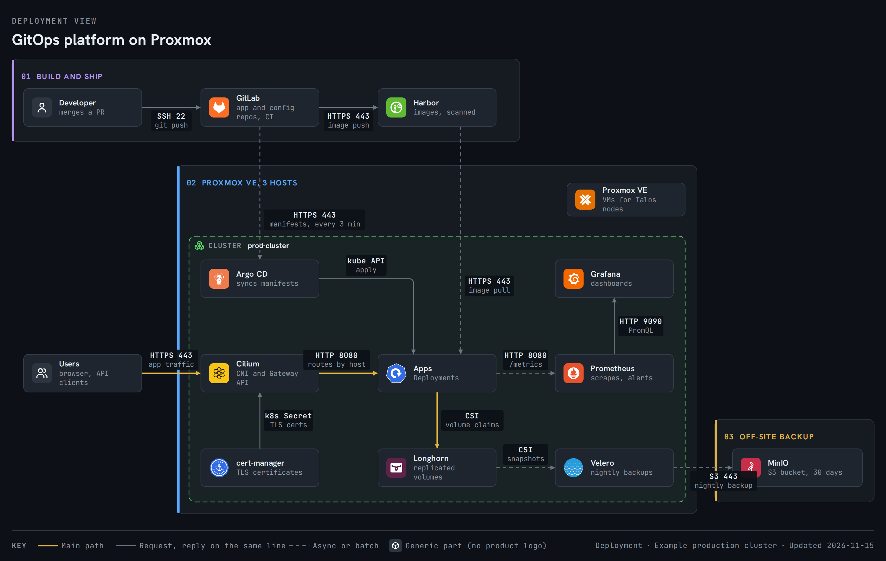
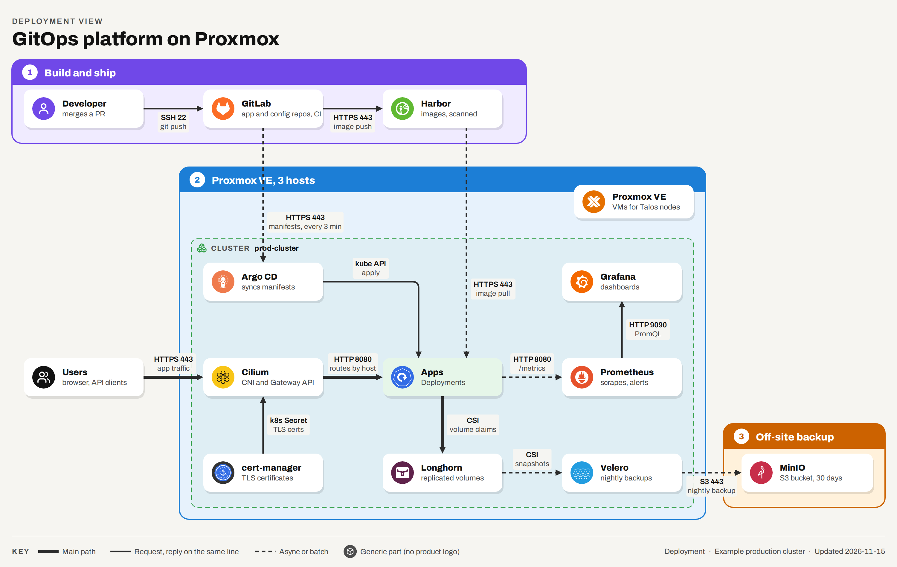

# cloud-native-diagrams

A Claude plugin for drawing architecture diagrams of cloud-native and infrastructure systems: Kubernetes clusters, CNCF projects (Argo, Flux, Harbor, Cilium, Prometheus and more), Proxmox and on-prem sites. Describe a system, or point Claude at your repo, and it draws the diagram with a real logo on every product and a label on every line.



It bundles 320 logos for Kubernetes objects, CNCF projects, Kubernetes distributions, Proxmox and virtualisation, servers and storage, networking, observability, AWS, Google Cloud and Azure.

This repo is a published copy. It is updated automatically, so please don't edit it here.

**Contents:** [The six looks](#the-six-looks) · [How to use it](#how-to-use-it) · [Install in claude.ai](#install-in-claudeai-reaches-chat-cowork-mobile-and-claude-code) · [If your work account won't add the marketplace](#if-your-work-account-wont-add-the-marketplace) · [Install in Claude Code only](#install-in-claude-code-only)

## The six looks

Every diagram is drawn in **Clear** unless you ask for another look by name. All six below are the same diagram (an example GitOps platform on Proxmox), so you can compare them directly. Click a picture to see it full size.

| Look | Good for | Preview |
|---|---|---|
| **Clear** (default) | ADRs, runbooks, READMEs, explainers: white canvas, colour with one named meaning, every line labelled. | [](docs/looks/clear.png) |
| **Sketch** | Design reviews, blog posts, talks: anything that should feel like a whiteboard and invite comment. | [](docs/looks/sketch.png) |
| **Blueprint** | Infrastructure and network detail, runbooks: when it should feel exact rather than friendly. | [](docs/looks/blueprint.png) |
| **Isometric** | Overview slides, posters and onboarding: where things run, at a glance. Not for detailed data flows. | [](docs/looks/iso.png) |
| **Dark** | Slides in a dark deck, on-call and SRE material, screens next to real dashboards. | [](docs/looks/dark.png) |
| **Infographic** | Social posts, onboarding, one-slide summaries: when it must read from across the room. | [](docs/looks/infographic.png) |

## How to use it

### 1. Ask for a diagram

Start your message with the draw command, then describe what you want in plain words:

- In **claude.ai** (chat, Cowork, mobile): type `/draw`
- In **Claude Code**: type `/diagrams:draw`

You can also just ask ("draw me an architecture diagram of...") and Claude picks the skill up by itself. The command makes sure it does.

### 2. Example prompts

Kubernetes and GitOps:

```
/draw our GitOps flow: developers push to GitLab, CI builds images into Harbor,
Argo CD syncs the config repo into three namespaces on a Talos cluster.
Show Cilium as the gateway and where cert-manager gets certificates.
```

```
/draw how a request reaches the checkout service: Cloudflare, the load balancer,
ingress-nginx, then the checkout and payment Deployments. Number the steps.
```

CNCF observability and delivery:

```
/draw our observability stack: apps send traces through the OpenTelemetry Collector
to Jaeger, Fluent Bit ships logs to Elasticsearch, Prometheus scrapes metrics into Thanos,
Grafana reads them all and PagerDuty pages on-call.
```

```
/draw how Flux promotes a release from dev to staging to prod clusters,
with the Harbor registry and the Git repos it watches.
```

Proxmox and on-prem:

```
/draw our on-prem site: a 3-node Proxmox cluster running RKE2, Ceph for block storage,
TrueNAS for backups, OPNsense and HAProxy in front. Mark the second site as planned.
```

From your own files (Claude Code, or any app where you've attached the files):

```
/diagrams:draw the architecture of this repo, from the Helm charts and Terraform in deploy/
```

Tips: name the real products (Claude puts their logos on; anything without a logo gets a plain icon), say which question the diagram should answer, and say who it is for. Claude asks only for what it can't work out.

### 3. Pick a look

Claude draws in **Clear** first. To get another look, say its name, in the first request or afterwards:

```
/draw ... in Blueprint
make it Sketch
same diagram in Dark for my slides
```

The names are **Clear**, **Sketch**, **Blueprint**, **Isometric**, **Dark** and **Infographic** (any case). Not sure which suits the job? Ask "which look is best for a conference talk?" and Claude recommends one. To see them all as pictures in a chat, type `/diagrams:styles` in Claude Code, or ask "show me the diagram styles".

### 4. Ask for changes

Reply in plain words, as you would to a colleague. Claude edits the diagram and draws it again:

```
add Velero backing up to a MinIO bucket off-site
move Grafana into the monitoring namespace
the line from Argo CD to the cluster should say "kube API 6443"
mark the second cluster as planned
drop the developer box, it's obvious
```

Claude keeps the diagram as a small model file, so changes and look switches never start from scratch.

### 5. What you get

- **PNG** (2x, sharp on slides and in docs) and **SVG** (fonts embedded, scales to any size).
- The **model file** (`<name>.json`): bring it back in a later chat and ask for changes or a new look.
- A **preview page** showing your diagram in every look, each with Download SVG and Download PNG buttons.
- On request: **Mermaid** for a README or ADR, a **sequence diagram** of the numbered steps, or a **draw.io** file you can edit by hand.

In Claude Code the files go in your project under `docs/diagrams/`. In claude.ai and Cowork they come back as files in the chat (or in your working folder in Cowork).

Before handing it over, Claude reads the picture back as a newcomer would and fixes crossed lines, missing labels and cramped boxes.

## Install in claude.ai (reaches chat, Cowork, mobile and Claude Code)

1. In claude.ai, open **Customize**, then **Plugins**.
2. Select **Add**, then **Add marketplace**, and enter `river-banks/cloud-native-diagrams`.
3. Find **diagrams** and select **Add**.
4. Open the marketplace and turn on **Sync automatically**.

Then type `/` in a new chat and look for **draw**.

## If your work account won't add the marketplace

Some organisations on a Team or Enterprise plan stop members adding marketplaces, so step 2 above ends with **Failed to add marketplace**. You can still use the skill:

1. Download [`diagrams-skill.zip`](https://github.com/river-banks/cloud-native-diagrams/raw/main/diagrams-skill.zip) from this repo (or run `curl -LO https://github.com/river-banks/cloud-native-diagrams/raw/main/diagrams-skill.zip`).
2. In claude.ai, open **Customize**, then **Skills**, select **Add** and upload the zip. It appears as the **diagrams** skill.

With the uploaded skill, start your request with `/diagrams` instead of `/draw`; everything in [How to use it](#how-to-use-it) works the same.

An uploaded skill doesn't update itself: download and upload the zip again when you want the newest version. If the upload option is missing too, your organisation has turned off member skills; ask an Owner to turn on **User-created skills** (Organization settings > Plugins & skills > Policy), or to allow this one marketplace in **Organization settings > Claude Code > Managed settings**:

```json
"strictKnownMarketplaces": [{"source": "github", "repo": "river-banks/cloud-native-diagrams"}]
```

Only use one copy: if the marketplace later works for you, remove the uploaded skill.

## Install in Claude Code only

```
/plugin marketplace add river-banks/cloud-native-diagrams
/plugin install diagrams@cloud-native-diagrams
```

Then use `/diagrams:draw` and `/diagrams:styles`.
