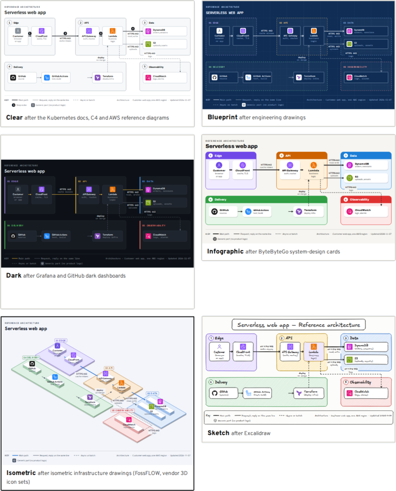
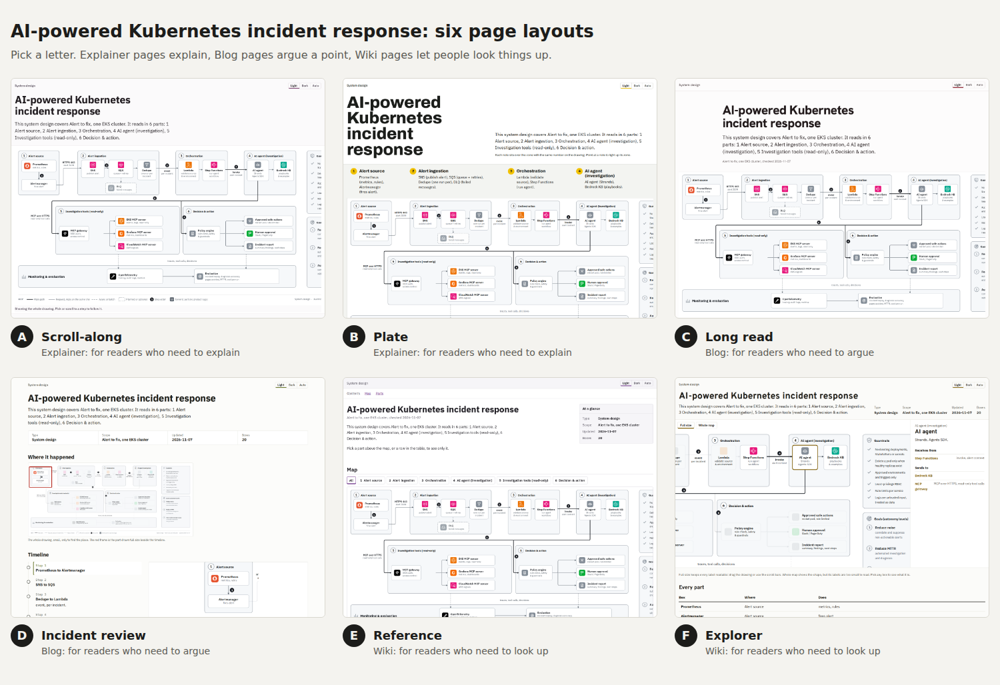

# Technical diagrams: styles and badges

A catalogue of looks for architecture and system diagrams, and a library of brand badges to put on them. A diagram is written once as data (an **example**), and every **style** in the catalogue can draw it, so you can try each look and pick the one that fits the job.

## Use it from any project: the `diagrams` plugin

This folder is also a plugin, so you never have to remember style names. It works in claude.ai chat (web, desktop and mobile), Cowork and Claude Code.

**Install it once per claude.ai account:** open **Customize > Plugins**, select **Add > Add marketplace**, enter `river-banks/cloud-native-diagrams` (the public copy of this plugin), add **diagrams**, and turn on **Sync automatically**. That reaches chat, Cowork, mobile and every Claude Code home signed in to that account, where it shows as `diagrams@synced`, and every update arrives by itself. If a restricted work account won't add the marketplace, upload the skill zip under **Customize > Skills** instead; it doesn't update itself. [The install guide](https://github.com/river-banks/cloud-native-diagrams#install-in-claudeai-reaches-chat-cowork-mobile-and-claude-code) has the steps, the zip, Claude Code-only installs and how to check it worked.

Then, in any project:

- **Just ask for a diagram** ("draw our checkout architecture"), or type `/diagrams:draw`. Claude writes the diagram as a model, draws it in the house standard, **Clear** (see [STANDARD.md](STANDARD.md)), and saves it as SVG and PNG next to the model in `docs/diagrams/`. Say a look by name ("in Sketch", "make it Dark") to get it in that look instead; the first time, it shows the six looks as a picture. Every product gets its logo from the badge library.
- **`/diagrams:styles`** shows the six looks and the badge library without drawing anything.
- **`/diagrams:page`** builds a page around a diagram from three choices: a layout (A Scroll-along, B Plate, C Long read, D Incident review, E Reference, F Explorer), a look and a theme (Light, Dark or Auto). Name them ("page, Long read, Blueprint, dark"), say "show me all" to pick from pictures, or say nothing and answer one question. See [Pages](#pages-around-a-diagram).

### For maintainers

What the plugin uses, all from this folder: `build.py styles` (list), `build.py find WORD` (badge lookup), `build.py preview MODEL.json` (the pick-a-style page, with Download SVG and PNG buttons), `export.js MODEL.json LOOK OUT` (SVG and 2x PNG; needs Node and Playwright), `thumbs/` (one PNG per style, `six-looks.png` for the offered looks and `contact-sheet.png` for every style), and `SKILL.md`. Build the plugin and the zip from this folder:

```
python3 build.py plugin       # writes ../plugins/diagrams, the plugin the marketplace serves
python3 build.py skill        # writes dist/diagrams-skill.zip, the uploadable skill
```

A new style or badge reaches users only when the `version` in `../plugins/diagrams/.claude-plugin/plugin.json` and the repo's `.claude-plugin/marketplace.json` is bumped (plugins are re-fetched only when the version changes). Run `node check.js --thumbs` after adding a style so its thumbnail exists.



## Pages around a diagram

`page.js` puts one model on a page: a **layout** picked by the reader's job, a **look**, and a **theme** (Light, Dark or Auto). The page carries both drawings (the light and dark twin) and a Light / Dark / Auto toggle, so the page and the diagram always switch together without a redraw. The rules are "Putting a diagram on a page" in [STANDARD.md](STANDARD.md); the layouts and the page's words are in [pages/README.md](pages/README.md).

```
node page.js MODEL.json --layout E --look clear --theme auto [--content PAGE.json] [--out OUT.html]
node page.js MODEL.json --sheet layouts           # six layouts on one lettered sheet
node page.js MODEL.json --sheet looks --layout E  # one layout in the six looks
node check-pages.js                               # every layout in every look and theme, in a browser
```



## Picker page

Open [`gallery.html`](gallery.html) to pick by picture: every kind (Map, Sequence), page layout, look and mix of them, each labelled with the words to ask for it, in Light or Dark (`node gallery.js` redraws it and `thumbs/gallery.png`, `gallery-dark.png` from the examples; see [pages/README.md](pages/README.md)).

Open [`picker.html`](picker.html) in a browser to compare every style on every example, and to browse the badge library. It is a single file with fonts and data built in, so it also works offline or published as an Artifact.

```
diagrams/
  styles/<id>.json        one file per style            add a file to add a style
  examples/<id>.json      one file per diagram model    add a file to add an example
  badges/catalogue.json   the badge source list         add a line to add a badge
  badges/own/<file>.svg   our own badge art             for anything with no public logo
  badges/own/k8s/         Kubernetes community icons (pod, svc, deploy, kubelet...), vendored
  badges/own/cncf/        CNCF project icons not on Simple Icons (KEDA, Kyverno, OPA...), vendored
  badges/own/lf/          Linux Foundation projects outside CNCF (agentgateway), vendored from their own repos
  badges/own/proj/        other projects with no Simple Icons or usable CNCF icon (Velero, Kamaji, Kube-OVN, LINSTOR), vendored from their own repos
  badges/own/gcp/         Google Cloud product icons from Google's icon zip, vendored
  badges/own/azure/       Azure Architecture Icons: NOTICE.md only until the zip can be fetched
  badges/vendor.py        refetches the vendored own/ folders and the Lucide glyphs, from pinned sources
  badges/glyphs.json      line icons for unbranded things (server, router, firewall, storage, vm...)
  badges/badges.json      built from catalogue.json, committed
  render.js               the one renderer every style uses
  model.js                reads a model (line ends, zone of a box, the text description); shared by the renderer and exporters
  page.html               the picker template
  picker.html             built page, committed
  build.py                build and lint; also styles, find and preview for the plugin
  check.js                renders every style x every example and fails on problems; --thumbs rewrites thumbs/
  export.js               saves one model in one style as SVG and PNG, or as Mermaid or draw.io (--no-header for a page)
  gallery.js              draws gallery.html and thumbs/gallery*.png: kinds, layouts, looks and mixes, light and dark
  gallery.html            built gallery, committed
  check-gallery.js        opens the gallery at 1280 and 400 px, light and dark, and fails on the gallery rules
  pages/_toggle.js        the one Light / Dark / Auto toggle (pages, picker, preview, gallery)
  page.js                 builds the page around a diagram: layout x look x theme, and the show-all contact sheets
  pages/                  the six page templates (A-F) and their shared _dg.css and _dg.js
  check-pages.js          loads every template in every look and theme and fails on the page rules
  convert.js              the text exports: Mermaid architecture and sequence, draw.io, an Excalidraw badge sheet
  thumbs/<style>.png      a thumbnail per style, contact-sheet.png, and page-layouts.png and page-looks-C.png (page.js sheets)
  SKILL.md                     the one source of the skill; build.py plugin copies it with every file into ../plugins/diagrams
  layout.js               auto layout with ELK for models whose boxes have no coordinates
  vendor/                 rough.js 4.6.6, elkjs 0.12.0 and the bundled fonts
```

## The standard: Clear

Every ADR, explainer, runbook and README diagram uses `clear`: a white canvas, grey structure, real logos, one named meaning for colour (`flows`), status as tags on the boxes (`tags`), and a label on every line. [STANDARD.md](STANDARD.md) has the rules, the best-practice sources behind them, the before and after, and a review checklist. `examples/lab-access.json` shows flows and tags.

## Six looks, picked by name

Clear is the default. Ask for any diagram in another look by its name ("draw it in Sketch", "export the Isometric one"); names and ids both work, in any case. [`thumbs/six-looks.png`](thumbs/six-looks.png) shows one diagram in all six.

| Look | id | Good for |
|---|---|---|
| **Clear (the default)** | `clear` | **Every technical diagram unless a look is named.** ADRs, explainers, runbooks, READMEs. |
| Sketch (after Excalidraw) | `sketch` | Design reviews, blog posts, talks: anything that should feel like a whiteboard. |
| Blueprint (after engineering drawings) | `blueprint` | Infrastructure and network detail, runbooks. |
| Isometric (after FossFLOW and vendor 3D diagrams) | `iso` | Overview slides, posters, onboarding: where things run at a glance. Not for detailed data flows. |
| Dark (after Grafana and GitHub dark) | `dark` | Dark decks, on-call and SRE material. |
| Infographic (after ByteByteGo) | `infographic` | Social posts, onboarding, one-slide summaries. |

Two more styles stay in the catalogue but are not offered: Cloud reference (`cloud`, after AWS reference architectures) and Transit (`swiss`, a explainer look). They still draw; use them only when asked for by name. A style's `"offered"` key decides which list it is in.

## Build and check

```
python3 build.py          # lint everything, then write picker.html
node check.js [shots/]    # render every style x example; optional PNG per pair
python3 build.py badges   # only after editing badges/catalogue.json (needs npm)
```

The renderer adds a footer under the model's `h`: the key and the type, scope and date line. Each style frames it like its title (a black rule for Transit, a hand-drawn box for Sketch, a thin rule elsewhere). The drawn size is on the SVG as `data-w` and `data-h`.

`build.py` lints before it builds and stops on: a model missing `type`, `scope` or `updated`, a style missing a field or using an unknown mode or font, two styles with the same id, a style with no row in the playbook page, an example node using a badge or glyph that does not exist, and `badges.json` out of date with the catalogue.
`check.js` needs Playwright with Chromium. It fails on page errors, text too long for its box, badges that drew nothing, sideways scroll at phone width, a diagram with no accessible title and description, a style whose text is under 4.5:1 or whose lines and zone edges are under 3:1 against what they sit on, a main path that only differs from other lines by hue (so it vanishes in greyscale), a line label under 12 px, and a line label the renderer could not place clear of boxes, zone titles and other labels (in the isometric view: clear of blocks, standing badges, plate titles and other labels), naming what it sits on. With a `shots/` folder it also writes a greyscale copy of each render to look at.

Every drawn SVG, on the page and exported, has `role="img"`, a `<title>` (the diagram's title and style) and a `<desc>` written from the model by `model.js` (type, scope, date, each zone and its boxes, then every line in step order with its label), joined with `aria-labelledby`. Screen readers read the description, so the labels you put on lines matter twice. Each box is one `<g class="node" data-id>` holding its rect, text and badge, and badges are plain `<g>` (never a nested `<svg>`), so a page can dim a box with its logo and select a diagram's own `<svg>` alone.

Run both before you commit.

## Add a badge

1. Add one line to `badges/catalogue.json`:
   - A product on [Simple Icons](https://simpleicons.org): `{"id": "kafka", "from": "si:apachekafka", "group": "data"}`. The slug is the file name on simpleicons.org. The name and brand colour come from Simple Icons; add `"name"` or `"hex"` to override.
   - An AWS service: `{"id": "glue", "name": "AWS Glue", "from": "aws:AWSGlue", "group": "aws"}`. The file name is from the `aws-icons` package, `icons/architecture-service/` (official AWS Architecture Icons).
   - Our own art: save the SVG (with a `viewBox`, no scripts) as `badges/own/acme.svg`, then `{"id": "acme", "name": "Acme", "from": "own:acme.svg", "group": "work", "hex": "#c4420a"}`. `hex` is used for the disc treatment.
2. `python3 build.py badges`, then `python3 build.py`.
3. Use it in a model as `"b": "kafka"`.

Groups are listed at the top of the catalogue; add a new one there if none fits. They cover AWS, Kubernetes objects and control plane, CNCF projects, security and policy, Kubernetes distributions, virtualisation and private cloud, servers and storage, networking and firewalls, operating systems, automation, observability, data, AI and identity, work tools and other clouds.

Kubernetes objects use the community icon set: `k8s-pod`, `k8s-deploy`, `k8s-svc`, `k8s-ing`, `k8s-sts`, `k8s-pvc` and so on, named after the `kubectl` short names; the control plane is `k8s-api`, `k8s-sched`, `k8s-c-m`, `k8s-kubelet`, `k8s-k-proxy`, `k8s-node`. Search the picker's badge library for the rest.

### Third-party art (Kubernetes, CNCF, other projects, Lucide)

Logos with no Simple Icons entry are vendored by `badges/vendor.py`, which fetches them from pinned commits, strips editor metadata, inlines CSS and prefixes ids so badges cannot clash on one page, then writes them into `badges/own/k8s/`, `badges/own/cncf/`, `badges/own/lf/`, `badges/own/proj/` and `badges/glyphs.json`. The output is committed, so a normal build needs no extra network. To add one, add its name to `K8S`, `CNCF`, `LF` (repo, commit and path, for a Linux Foundation project outside cncf/artwork), `PROJ` (repo, commit, path and an optional `viewBox` that crops a logo to its mark, for any other project) or `GLYPHS` in the script, run `python3 badges/vendor.py`, then add the catalogue line as for your own art (`"from": "own:cncf/keda.svg"`). The script refuses raster art.
Package versions are pinned in `build.py` (`aws-icons` 3.3.0, `simple-icons` 16.36.0). To upgrade, change the pin and rebuild; check the diff for removed logos.

Simple Icons does not carry AWS, Azure or Slack logos (their owners asked for removal). AWS comes from the AWS icon kit, which AWS allows in architecture diagrams.

Google Cloud products come from Google's own icon zip (`python3 badges/vendor.py gcp`, pinned by sha256, ids `gke`, `gcp-run`, `gcp-sql`, `gcp-pubsub` and so on; terms in `badges/own/gcp/NOTICE.md`). Azure is wired up the same way from Microsoft's Azure Architecture Icons zip (`python3 badges/vendor.py azure`; ids will be `az-aks`, `az-vnet`, `az-keyvault`...), but is not bundled yet: the zip's host was blocked where this was built. `badges/own/azure/NOTICE.md` has the terms and the three steps to add it. Until then, use a glyph for Azure services. For Slack, draw your own badge or use a glyph.

## Add a glyph

Glyphs are line icons for things with no brand (an agent, a policy, a report). Add a path on a 24 x 24 grid, drawn as a stroke, to `badges/glyphs.json`, and use it as `"b": "g:name"`.

## Add a style

1. Copy the style file closest to what you want, for example `styles/blueprint.json` to `styles/mystyle.json`, and set `"id": "mystyle"` (lower case, matching the file name), a `name` no other style uses (people ask for a look by it), an `order` (styles sort by it in the picker) and `"offered"`.
2. Change the fields (below). Keep the five palette colours: zones and panels pick from `violet`, `blue`, `amber`, `green`, `red`.
3. Add a `<li data-style="mystyle">` row to the diagrams part of `playbook/cloud-native-diagrams.html` and a row to the six-looks table above if `offered` is true (or to the "not offered" sentence below it if false). An offered look also needs a frame on `thumbs/six-looks.png` and its name in the draw rules (`SKILL.md`, then run `python3 build.py plugin`, and `STANDARD.md`).
4. `python3 build.py && node check.js --thumbs`, and look at the picker. `--thumbs` makes the thumbnail the plugin shows.

If the look needs something the renderer cannot do yet (a new zone or title treatment), add a new `mode` in `render.js` and to `MODES` in `build.py`, rather than checking the style id in the renderer.

| Field | What it sets |
|---|---|
| `offered` | Required. `true`: one of the looks offered by name (the default, Clear, must be). `false`: kept and drawable, but not offered. |
| `name`, `after`, `blurb`, `good`, `rules`, `source`, `swatch` | The words and colour chip shown in the picker and playbook. |
| `bg`, `grid` | Paper colour; `grid: 1` draws a measuring grid. |
| `font`, `subFont`, `ink`, `sub` | Fonts for names and roles (must be in `vendor/fonts` and `FONTS` in `build.py`), and their colours. |
| `rough` | Present = hand-drawn with rough.js (`roughness`, `bowing`). |
| `pal.<colour>` | `stroke`, `fill`, `hatch` per zone colour. |
| `zone` | `mode`: `tint`, `outline`, `header`, `dash`, `rule`, `bar` or `iso`; plus corner `r`, stroke `sw`, title `size`. |
| `iso` | For `zone.mode: "iso"`: scale `k`, block height `depth`, slab thickness `plate`. The iso mode projects the whole model: zones become raised plates (nested ones a step higher), boxes become blocks inset in their footprint with the logo standing on top, lines stay on the ground, and each line's label stands upright beside it, clear of blocks, badges, plate titles and other labels. |
| `node` | Box `fill`, `stroke`, `sw`, `r`; name and role sizes; badge treatment `badge` (`native`, `tile`, `disc`, `chip`) and size `bs`; `weight`, `shadow`, `tone`, `tileR`; `glyphTile` `{bg, fg}` for glyph badges; `hero` `{fill, stroke}` for the node marked `hero` (`"zone"` takes the zone colour). |
| `edge` | Line colour `c`, width `sw`, head `open` or `solid`, corner `r`, `steps: 1` for numbered step markers, `stepFill` and `stepInk` for the marker's disc and number, `hot` `{c, sw, under, usw}` for the main path. |
| `title` | `mode`: `box`, `band`, `left` or `none`; `size`, `weight`, `upper`. |
| `card`, `rule` | Optional surfaces: `card` fills the Sketch title box and number discs (default white), `rule` is the Transit rule colour (default black). |
| `dark` | Required. The fields to change for a dark page, laid over the style (objects merge): usually `bg`, `ink`, `sub`, `card`, `pal`, `node.fill`, `edge.c`. `{}` for a style that is dark already. |

### Dark versions

Every style has a dark version from its `dark` block. The picker and preview have a Light / Dark / Auto toggle that switches the whole page with every drawing (or `?theme=dark`), their downloads are named `-dark`, and `node export.js MODEL.json STYLE OUT --theme dark` saves it (`--theme both` writes `OUT.svg`/`.png` and `OUT-dark.svg`/`.png` in one run). `check.js` renders every style both ways and runs the contrast checks on both.

## Places inside places: nested zones

Real systems run in places inside places: a namespace in a cluster in a VPC in a region, or a VLAN in a rack in a site. Give the inner zone `"in": "<outer zone id>"` and a `kind`. Top-level zones keep their style's stage look; nested zones are drawn as boundaries in that style's colours and corners, with the kind's icon and a small caps tag (`CLUSTER prod-eks`). The line says what kind of boundary it is: solid for cloud, region, site and node; dashed for vpc and cluster; fine dashes for subnet, namespace and vlan. A nested zone takes its parent's colour unless it sets its own `c`, and a box takes the colour of the innermost zone it sits in. `build.py` checks that `in` names a zone, that zones are not inside each other in a loop, and that a placed child does not stick out of its parent.

## Auto layout

Placing boxes by hand is the slow part. Leave `x`, `y`, `w` and `h` off the boxes and zones, put every box in its zone with `"in": "<zone id>"`, and give every edge `"from"` and `"to"` (box ids) instead of `pts`. `build.py preview`, `build.py page` and `export.js` then lay it out with ELK's layered algorithm (`layout.js`, elkjs 0.12.0 vendored in `vendor/`, so no network), left to right, or top to bottom with `"direction": "down"`. Edge labels get room reserved between columns. `w` and `h` become optional.

- Boxes that do have `x` and `y` are locks: they stay put and their lines get a simple orthogonal route.
- `"free": 1` on an edge keeps it out of the layering, so the boxes it joins can stack in one column (a short chain like developer, GitHub, CI inside one zone); it gets a simple route after.
- A hand-placed model can also use `from` and `to` without `pts` on any edge: it gets the simple route.
- To start from the automatic layout and then fine-tune by hand: `node layout.js MODEL.json PLACED.json` writes the model with every coordinate filled in.

Auto layout needs Node. See `examples/kubernetes-platform.json`.

## Add an example (a diagram model)

Copy the closest example and edit: `examples/serverless-web-app.json` (small), `examples/incident-response.json` (full, with side panels), `examples/kubernetes-platform.json` (region, VPC, cluster and namespaces, laid out automatically) or `examples/on-prem-site.json` (site, VLANs, Proxmox hosts and an RKE2 cluster, placed by hand). Coordinates are in drawing units on an 8 to 20 px grid; `w` and `h` set the canvas. Leave about 100 units at the top for the title.

| Key | Holds |
|---|---|
| `id`, `order`, `title`, `kicker`, `code` | Names; `code` is the two letters on the Transit title band. |
| `type`, `scope`, `updated` | Required. What kind of picture it is (`Architecture`, `Deployment`, `Data flow`), what it covers (`Production, eu-west-1`), and the date it was last checked (`2026-11-07`). Printed beside the key. |
| `contract` | Optional: five lines written before the model (the question it answers, the reader, what must show, what is left out, where it is shown). Not drawn; the draw skill reads the picture back against it. |
| `key` | `false` hides the key. Otherwise the renderer draws one under the diagram from what the model uses: main path, line kinds, planned boxes, step numbers, generic glyph tiles. |
| `zones[]` | Numbered stage areas: `id`, `n`, `t`, `x`, `y`, `w`, `h`, `c` (palette colour), optional `inline` glyph for a one-row zone. A zone with `in: "<zone id>"` sits inside another and is drawn as a boundary; `kind` says what it is: `cloud`, `region`, `vpc`, `subnet`, `cluster`, `namespace`, `node`, `site` or `vlan`. |
| `nodes[]` | Boxes: `id`, `t` (name), `s` (role lines), `b` (badge id or `g:glyph`), `x`, `y`, `w`, `h`; `lay: "top"` puts the badge above the name; `hero`, `ghost` (planned or optional: dashed outline), `tone`. |
| `edges[]` | `pts` (orthogonal point list), `l` (label: `["HTTPS 443", "what moves"]`, protocol and port first), `head` (`end` or `none`), `step` number, `hot` (main path), `f` (flow id, colours the line), `dash` (async or batch), `dot` (still to confirm), `tee` (joins a line). |
| `flows` | What colour on the lines means, once per diagram: `{"api": {"t": "Kubernetes API", "c": "blue"}}`. Colours: `blue`, `orange`, `green`, `pink`, `sky`, `vermillion`, `grey` (Okabe-Ito, colour-blind safe), at most five. Each flow is listed in the key. |
| `tags` | Status pills for boxes: `{"new": {"t": "New rule", "k": "bad", "m": "router rule to add"}}`; kinds `bad`, `good`, `info`. A node takes `"tag": "new"`. Each tag used is listed in the key with its `m`. |
| `labels[]` | Free text on a line: `t`, `x`, `y`. |
| `panels[]` | Side lists: `t`, `icon`, `c`, box, `kind` (`check` or `num`), `items` (lines per item). |

Keep names short with the role underneath, one badge per named product, and run `node check.js`: it tells you which text does not fit.

Lines mean the same thing in every style: **solid** is a request (the reply comes back on the same line), **dashed** (`dash`) is async or batch, **dotted** (`dot`) is still to confirm. Arrows point the way the data goes; if data really flows both ways, draw two edges. Label every line that crosses from one zone to another with two short lines, protocol and port first (`"l": ["SQL 5432", "each write"]`). The renderer puts the label beside the line's longest clear stretch, off boxes, other labels and zone titles; leave room for it (about 100 units between boxes for a horizontal line). `build.py` warns about unlabelled lines between zones and about `head: both`.

## Other views and formats

- **Sequence view.** A model whose main path carries `step` numbers can also be drawn as a sequence diagram: one box per participant in step order, a lifeline under each, one arrow per step with its label. The picker shows Map and Sequence buttons when a model has steps; `node export.js MODEL.json STYLE OUT --view sequence` saves it. It is built by `DiagramModel.sequence()` in `model.js` as an ordinary model, so every style and the dark versions draw it.
- **Mermaid**, for READMEs, issues and ADRs: `node export.js MODEL.json mermaid [OUT]` writes `OUT.mmd` as `architecture-beta` (zones become groups, nested zones nest, boxes become services with `logos:` icons from Iconify, lines keep their sides). Mermaid's architecture diagrams have no line labels, so labels, steps and line kinds go in `%%` comments above each line. The `logos:` icons need the Iconify logos pack registered (`mermaid.registerIconPacks`); add `--icons builtin` for renderers without it, such as GitHub. `node export.js MODEL.json sequence [OUT]` writes the step edges as a `sequenceDiagram`. The badge-to-icon table is `badges/mermaid-logos.json`, rebuilt by `build.py badges` from `@iconify-json/logos` 1.2.16.
- **draw.io**: `node export.js MODEL.json drawio [OUT] [--style cloud] [--theme dark]` writes `OUT.drawio`: zones as containers (nested ones inside their parents, dashed by kind), boxes with their name, role and badge image, lines glued to their boxes with the same waypoints, labels, dash and colours from the chosen style. Open it in draw.io or diagrams.net and move things freely.
- **Excalidraw**: `node convert.js badges OUT.excalidraw [WORD...]` writes every badge (or the ones matching the words) as an Excalidraw scene, grouped by badge group with names under them. Open it and copy badges into your drawing. It is a scene, not an `.excalidrawlib`, because Excalidraw libraries cannot hold images.

These text formats need only Node (no browser), and lay out models without coordinates first. The Mermaid output is checked by parsing it with Mermaid 11; the draw.io output by checking every line is glued to a box that exists. Neither was opened in the draw.io or Excalidraw apps when this was built, so look at the first file you make.

## Licences

Badges: AWS Architecture Icons (AWS permits use in architecture diagrams), Simple Icons glyph data (CC0; each logo stays its owner's trademark, so use it only to name the product), the Kubernetes community icon set (CC-BY-4.0, credit in `badges/own/k8s/NOTICE.md`), CNCF project artwork (Linux Foundation trademark guidelines: name the project, do not alter the logo or imply endorsement; `badges/own/cncf/NOTICE.md`). Glyphs: ours plus Lucide (ISC, with Feather MIT; `badges/LUCIDE-LICENSE`). Fonts: Excalifont, IBM Plex, Archivo, Overpass, Hanken Grotesk, JetBrains Mono (all SIL OFL). rough.js (MIT, `vendor/rough-LICENSE`). elkjs (EPL-2.0, `vendor/elk-LICENSE.md`; used unchanged).
