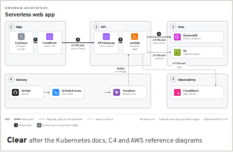

# The diagram standard

Every technical diagram we make uses one format, the **Clear** style (`clear`). A diagram is there to make the reader understand something faster than the prose would. Brand themes, signal yellow and heavy black bands help a page look like ours. They do not help a reader trace a packet, so they stay out of the drawing.



## The rules

1. **One question per diagram.** Write it in the model's `contract` before drawing ("How does each kind of traffic get into the lab?"). If the diagram has to answer two questions, draw two diagrams.
2. **Neutral canvas.** White (or the dark-page twin), grey zone outlines, grey text for roles. The page's theme (Transit bands, yellow tiles, brand colour) belongs in the page around the diagram, never inside it.
3. **Colour means one thing per diagram, and the key says what.** Name it in the model's `flows` ("which door", "which kind of traffic", "which team owns it"). Use at most five hues, from the colour-blind-safe Okabe-Ito set the renderer ships. Every hue appears in the key and on its line. Never encode meaning with line patterns alone, and never let one colour mean two things.
4. **A real logo on every product.** Use the badge library (`build.py find`). A reader recognises Cilium, KubeVirt or Talos before reading the name. Use a grey glyph only for unbranded things (people, a router, a database role).
5. **Every line says what moves.** Protocol and port first, then the payload: `["TCP 6443", "kubectl, virtctl"]`. Arrows point the way the data goes. The line meanings are fixed in every style: solid is a request, dashed is async or batch, dotted is still to confirm.
6. **Status is a tag, not a colour.** A box that needs a new rule, is planned, or is broken gets a pill on its top edge (`tags`). That way line colour never has to mean status as well.
7. **Read in one direction.** Use left to right for request paths and top to bottom for layers. Zones are numbered in reading order (who, network, platform, workload). Boxes are named on top with their role underneath.
8. **Small enough to hold in your head.** About 20 boxes at most. Past that, split the diagram by question (one access map, one deployment view) rather than shrinking the type. All text is at least 12 px at the size it is shown: node titles and sub-lines, tags, the key, zone and line labels. Text that does not fit wraps or gets a wider box instead of shrinking; `check.js` fails on any text under 12 px, with no exemptions.
9. **Say what it is and when.** Every diagram prints its `type`, `scope` and `updated` date beside the key. The renderer does this for you.

## Why this format: diagrams that work

| Source | What it does | Why it helps |
|---|---|---|
| [Kubernetes docs diagram guide](https://kubernetes.io/docs/contribute/style/diagram-guide/) | Plain boxes, a small fixed colour set, labelled arrows, one diagram per idea, the diagram explained in the text beside it | Readers who know only some of the parts can still follow the flow. The style never competes with the content. |
| [C4 model notation checklist](https://c4model.com/diagrams/notation) | Every diagram has a title, a stated type and scope, a key, and every line is labelled with its intent and technology | Colour and shape are always explained, so nothing has to be guessed. Our `type`, `scope`, `updated` and fixed line meanings come from here. |
| AWS reference architectures ([icon kit and rules](https://aws.amazon.com/architecture/icons/)) | Official service icons, groups as thin outlines, numbered steps on the main path | Readers who know the console spot every service by its icon. Outlines show boundaries without colouring everything. |
| Okabe and Ito, [Color Universal Design](https://jfly.uni-koeln.de/color/) | Eight hues that stay distinct for the common kinds of colour blindness | Colour can carry meaning for about 1 in 12 men who would otherwise lose it. |
| Our own `diagrams/` Cloud reference style | The closest existing style to this standard | It already scored best in the 2026-11-07 review. `clear` keeps its outlines and logos and adds named flows and tags. |

## How to draw one

Write the diagram as a model (see the draw skill and `examples/`), then:

```
node export.js docs/diagrams/<id>.json clear docs/diagrams/<id>
```

The two keys that carry the standard:

```json
"flows": {
  "api":  {"t": "Kubernetes API", "c": "blue"},
  "web":  {"t": "Web and gRPC",   "c": "orange"}
},
"tags": {
  "new":  {"t": "New rule", "k": "bad",  "m": "router rule to add"},
  "open": {"t": "Open",     "k": "good", "m": "already allowed"}
}
```

Give an edge `"f": "api"` to colour it, and a node `"tag": "new"` to pin a pill on it. The flow colours are `blue`, `orange`, `green`, `pink`, `sky`, `vermillion` and `grey`, each at least 3:1 on every style's background (`check.js` holds them to it), with a lighter twin on dark pages. The tag kinds are `bad` (filled red), `good` (green outline) and `info` (grey outline). The key lists only the flows and tags the diagram uses. `build.py check` refuses an unknown flow or tag, two flows that share a colour, and a tag with no text. It warns past five flows, and when one diagram uses both `blue` and `sky` (they look alike on white).

When a diagram has no flows, colour is not needed. The main path is drawn in thick ink (`"hot": 1`) with numbered steps, and everything else stays grey.

## Other looks

Clear is the default. Any diagram can be drawn in another look when someone asks for it by name: **Sketch** (a whiteboard feel), **Blueprint** (exact, engineering-drawing feel), **Isometric** (3D overview for a poster or slide), **Dark** (for dark decks and screens next to dashboards) or **Infographic** (a bold card for social posts). The same model draws in every look, so switching is one export with another name. The rules above still apply in every look: flows, tags, logos and labels work in all of them. Without a named look, draw in `clear`. `cloud` (Cloud reference) and `swiss` (Transit) stay in the catalogue but are not offered.

## Review checklist

Before a diagram ships, a reader who has never seen the system should be able to answer yes to all of these:

- Can I say in one sentence what question this diagram answers?
- Does every colour on it appear in the key, and mean only one thing?
- Can I name every product from its logo?
- Does every line crossing a boundary say what moves and on which port?
- Is status (new, planned, broken) shown as a tag rather than a colour?
- Does it read in one direction, with zones numbered in that order?
- Is there a type, a scope and a date?

## Putting a diagram on a page

Other pages squeezed our diagrams into a text column at 40% size, put a dark drawing on a light page, and numbered their steps differently from the drawing. A page is built around the diagram instead (`page.js`, the `/diagrams:page` command; layouts in [pages/README.md](pages/README.md)):

1. **Draw for the frame.** A page diagram is drawn about 1200 to 1400 px wide.
2. **Never show a diagram below 85% of its drawn size.** Crop to the part that matters or let the reader pan; never shrink it to fit.
3. **The page owns the title.** Export the diagram without its own header (`export.js --no-header`), so there is no empty band above it.
4. **Match the theme.** A dark page gets the dark twin, a light page the light twin. Every page ships both and switches them with the page.
5. **One numbering.** Steps in the text use the drawing's numbers.
6. **Answer first.** Say what the picture shows before walking through it.
7. **Captions say what to look at,** not what tool made it.
8. **Load IBM Plex Sans for diagram text.** (Clear's face. A page loads the faces its drawing uses and at most two families in all.)
9. **Pick the layout by the reader's job:** explain (A Scroll-along, B Plate), argue (C Long read, D Incident review) or look up (E Reference, F Explorer).

`check-pages.js` holds every layout to rules 2 to 4 and 8 in a browser, in every look and both themes.

## In an explainer

An explainer page built around a diagram uses the diagram-first layout in the transit kit
(`transit/templates/diagram-first.html`, rules in `transit/README.md`): the answer in one sentence,
this diagram full width, a choice button per path that lights that path up, and numbered steps
whose numbers also sit on the drawing. Every exported edge and every edge's label carries `data-i` (its
index in `edges`) and `data-f` (its flow), which is how the page finds a path's lines.
