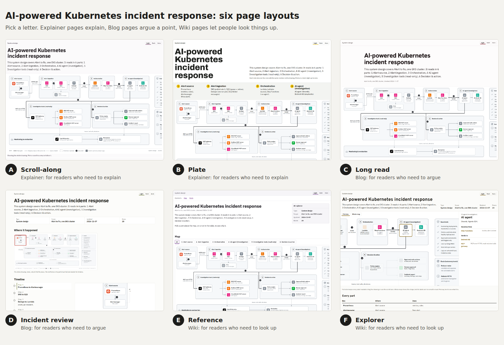

# Page templates: the page around a diagram

Six layouts for a page built around one diagram, grouped by the reader's job. `../page.js` fills one with a model, a look and a theme and writes one self-contained HTML page (fonts, both drawings and the script inlined; no network).

| | Layout | For readers who need to | What it does |
|---|---|---|---|
| A | Scroll-along (Explainer) | explain | The answer first, then the drawing held at the top while numbered steps scroll under it and light up their part. |
| B | Plate (Explainer) | explain | The drawing edge to edge; each note sits over the numbered zone it explains (cards above the plate when notes would collide, and for Isometric). |
| C | Long read (Blog) | argue a point | A reading column with margin notes; figure 1 breaks out to full width, a section can add a full-size crop of its own boxes. |
| D | Incident review (Blog) | argue a point | Status strip, a small locator of the whole drawing, then a timeline driving a full-size crop beside it. |
| E | Reference (Wiki) | look things up | Lead and fact box, the drawing across the content width, a table whose rows light up their path (one per flow, else per zone). |
| F | Explorer (Wiki) | look things up | The drawing at full size in a pannable canvas, with a panel that says what any box is and what it talks to. |

```
node page.js MODEL.json --layout C --look Blueprint --theme dark --content PAGE.json --out OUT.html
node page.js MODEL.json --sheet layouts            # the six layouts on one lettered sheet (HTML and PNG)
node page.js MODEL.json --sheet looks --layout C   # layout C in the six looks
node check-pages.js                                # every layout x look x theme in a browser (scripts/check runs it)
```



## The page's words: `--content PAGE.json`

Everything is optional; what is left out is written from the model, so a page builds from the model alone. Text takes `` `code` `` and `**bold**`; nothing else is HTML.

| Key | Used by | Holds |
|---|---|---|
| `title`, `answer` | all | The page title and the answer in one or two sentences (rule 6: say what the picture shows first). |
| `crumb`, `meta`, `caption` | all | The line above the title, the byline or date line, and the caption (rule 7: what to look at, not what made it). |
| `steps` | A, C chips, D | `[{"n": 1, "h": "heading", "p": "text", "edges": [0], "nodes": ["id"]}]`. `n` is the number on the drawing (a step marker, or a zone number when the look draws no step markers). Default: one per step, else one per zone. |
| `notes` | B | Same shape, one per numbered zone (`n` is the zone number). |
| `sections` | C | `[{"h", "p": ["para", ...], "aside", "chips": [1, 2], "crop": true, "cropNodes": ["id"], "cropCaption"}]`. `crop` adds a figure of the same drawing cut to `cropNodes` (or the section's `nodes`) at full size. |
| `timeline`, `impact`, `strip` | D | `[{"time": "14:02", "h", "p", "nodes", "edges", "impact": true}]`; `impact` `["Customer impact", "41 min of 500s"]`; `strip` replaces the facts in the status strip. |
| `facts` | D, E, F | `[["Region", "eu-west-1"], ...]`. Default: type, scope, updated, box count, then each status tag and its boxes. |
| `doors` | E | Rows that light up their part. Default: one per flow (`f`), else one per numbered zone. |
| `owners`, `notesById`, `start` | F | `{"box id": "Owner"}`, `{"box id": "a line for the panel"}`, the box picked first. |
| `more` | all | Extra sections at the end: `[{"h": "What we are changing", "p": ["...", "..."]}]`. |

## How the templates work

- Each template is plain HTML with placeholders `page.js` fills: `<!--LANG-->`, `<!--TITLE-->`, `<!--ANSWER-->`, `<!--CRUMB-->`, `<!--META-->`, `<!--CAPTION-->`, `<!--TOGGLE-->`, `<!--FIG:name-->` (one drawing; a page can have several), `/*FONTS*/`, `/*DGCSS*/` (`_dg.css`) and `/*DGJS*/` (`PAGE`, `MODEL` and `_dg.js`). The template's colours are two blocks, `@theme light {...}` and `@theme dark {...}`, which `page.js` writes out for Auto (`prefers-color-scheme`) and for the toggle (`data-theme` on `<html>`).
- A `.dg` box holds the two twins as its only `<svg>` children (`.dg > svg.dg-l`, `.dg > svg.dg-d`). CSS shows one; a theme change never redraws. Badges are `<g>` inside their `.node`, so `.dg > svg` never hits a badge and dimming a box dims its logo.
- Focus never costs the words: a box or label that is not lit fades its shapes, and its text takes the twin's ink (`--dg-ink`, which `page.js` sets on each twin), and a line label keeps its plate, so its words keep 4.5:1 on what is under them. Layout A is complete at rest: the whole drawing shows at load and whenever no step card is in the reading band.
- `_dg.js` gives every template `DG.light` (focus on edges, flows or boxes), `DG.crop` / `DG.uncrop` (cut to some boxes at full size), `DG.reveal` (scroll a box into view), `DG.adopt` (moves badges into their box in drawings from before plugin 1.7.0) and the toggle.
- Size: `.dg` is never narrower than 85% of its drawn width (`--dg-min`); a wider drawing scrolls or pans. Only the locator in D (marked `data-locator`) and F's "Whole map" (the reader's choice) show it smaller.
- Fonts: at most two families per page. The drawing's faces come first (IBM Plex Sans for Clear); the layout's own face is added only when there is room. Accents stay outside hues 150-260 and 15-40 in both themes.
